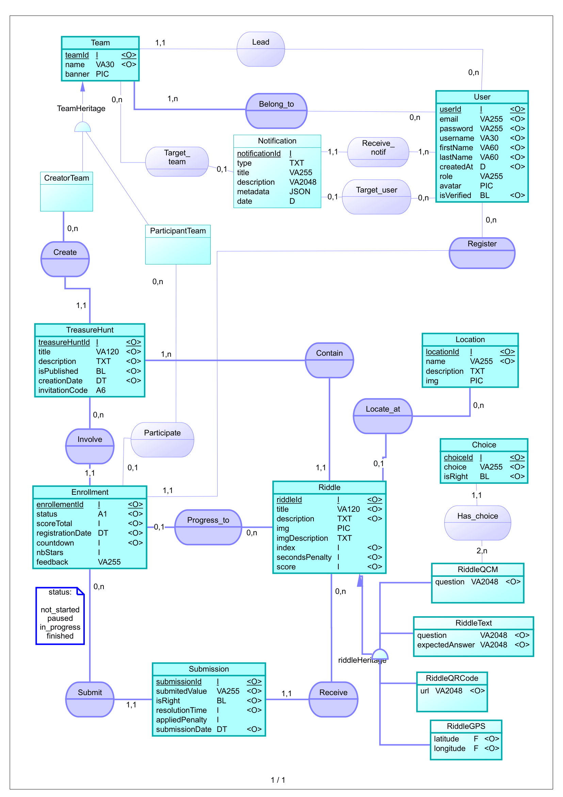

# sae5-01-back

## Project Presentation

### Introduction

This back-end repository is part of an academic project (SAÉ 5.01) carried out as a team of five students from the IUT of Reims.
The goal of this project is to build a complete, containerized treasure hunt web application following an agile methodology.

The application allows administrators to create and manage treasure hunts, geographical riddles
(text, multiple-choice questions, QR codes, GPS-based locations),
and user accounts, while providing a secure API consumed by a React front-end application.

### Features

- Authentication & Authorization: Secure JWT-based authentication with role-based access control separating creators and players.
- Treasure Hunt Management: Full CRUD operations for designers to create, update, delete, and organize treasure hunts and their associated multi-type riddles (text, MCQ, QR code, GPS).
- Progression & Scoring: Tracking system for players to register for hunts, solve riddles sequentially, handle time penalties for incorrect answers, and pause or complete challenges.
- Data Fixtures & Testing: Comprehensive fake and real data fixtures alongside automated test suites ensuring application stability and security.

## Authors

| Name               | GitLab IDs       | Role       |
|--------------------|------------------|------------|
| Natan Sorel        | @sore0012 Limeen | Owner      |
| Gaël Lefèvre       | @lefe0306        | Maintainer |
| Sandjy Gaudin      | @gaud0055        | Maintainer |
| Tony Hadj Sadoun   | @hadj0030        | Maintainer |
| Wassime Moussaoui  | @mous0111        | Maintainer |

### Tech Stack

This project is built using the following technologies:
* **Framework:** Symfony 7.4 (PHP 8.4+)
* **Database:** PostgreSQL (v16-alpine) via Docker
* **Dependency Manager:** Composer
* **Frontend:** Twig
* **Containerization:** Docker & Docker Compose

### Code Quality Tools
To maintain high coding standards, we use:
* [PHP CS Fixer](https://cs.symfony.com/): Automatically fixes PHP coding standards.
* [Twig CS Fixer](https://github.com/VincentLanglet/Twig-CS-Fixer): Linter and fixer for Twig templates.
* [PHPStan](https://phpstan.org/documentation): PHP Static Analysis Tool that finds bugs in your code without running it.
* [GrumPHP](https://github.com/phpro/grumphp): A code quality tool that runs tasks like linters, tests, and static analysis whenever you commit changes.

### Development Workflow (Agile)

The project follows an **Agile** methodology via **GitLab** to ensure code quality and feature tracking:
* **Backlog Management:** GitLab *Issues* are used to track tasks and bugs.
* **Branching Strategy:**
    * `main`: Stable protected production branch.
    * `feature/feature-name`: Development of new features.
    * `fix/bug-name`: Bug fixes.
* **Quality Assurance:** Every branch requires a **Merge Request (MR)**. A code review by another team member is mandatory before any fusion into the main branch.

## Installation

```
git clone https://iut-info.univ-reims.fr/gitlab/sore0012/sae5-01-back
```

```
docker compose up -d
```

```
composer install
composer db
composer start
```

## Scripts composer

- ``start`` : Starts the Symfony server with timeout disabled
- ``test:phpcs`` : Checks PHP code style without applying changes
- ``fix:phpcs`` : Applies style fixes to PHP code
- ``test:twigcs`` : Checks Twig code style without applying changes
- ``fix:twigcs`` : Applies style fixes to Twig code
- ``test:phpstan`` : Checks PHP code format depending on phpstan conditions
- ``test:yaml`` : Does a verification for each YAML file within in config/
- ``test:codeception`` : Run the code tests after initializing the test database
- ``test`` : Runs all code checks
- ``fix`` : Applies all code fixes
- ``db`` : Recreates the DB, applies migrations, and loads fixtures
- ``fix:db``: Resets the DB and migration history, dropping and recreating the database, generating a fresh initial migration, and running database setup.

## JWT Public key and Private key (generated during composer start)
You might need to generate both a public and private key to access the **JWT** (Json Web Token) feature
by running the follow command in your terminal :
```shell
php bin/console lexik:jwt:generate-keypair [--skip-if-exists] [--overwrite]
```

Where :
- `--overwrite` will regenerate the keys if they already exist.
- `--skip-if-exists` to do nothing if they already exist.

### Accounts

| Type de compte | Email                   | Username    | Rôles            | Mot de passe |
|----------------|-------------------------|-------------|------------------|--------------|
| **Admin**      | `admin@example.com`     | `admin`     | `ROLE_ADMIN`     | mdp          |
| **User**       | `user@example.com`      | `user`      | `ROLE_USER`      | mdp          |
| **Conceptor**  | `conceptor@example.com` | `conceptor` | `ROLE_CONCEPTOR` | mdp          |

### Conceptual Data Model


